<p align="center">
  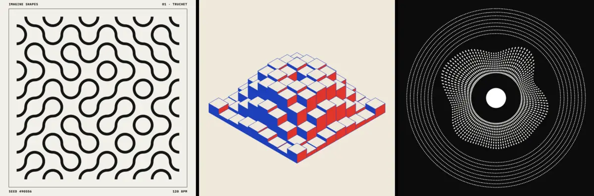
</p>

<h1 align="center">IMAGINE SHAPES</h1>

<p align="center">
  Formas generativas em camadas, no tempo da música.<br>
  Para cartaz (SVG e PNG), vídeo (MP4) e projeção ao vivo.<br><br>
  Criado por <a href="https://marciusm.com"><b>Marcius Monteiro</b></a>
</p>

<p align="center">
  <a href="#tutorial">Tutorial</a> ·
  <a href="#como-usar">Como usar</a> ·
  <a href="#como-funciona">Como funciona</a> ·
  <a href="#as-formas">As formas</a> ·
  <a href="#composições">Composições</a> ·
  <a href="#vídeos">Vídeos</a> ·
  <a href="#como-foi-desenvolvida">Como foi desenvolvida</a> ·
  <a href="#créditos-e-licença">Créditos</a> ·
  <a href="docs/MANUAL.md">Manual completo</a> ·
  <a href="#in-english">English</a>
</p>

---

IMAGINE SHAPES é uma ferramenta para criar formas e padrões geométricos em movimento. Grades, raios, fluxos, ruído, isométricos, distorções, formas orgânicas, física e padrões são camadas que se combinam em composições. Cada camada tem parâmetros, semente própria e um movimento que fecha no loop. As camadas andam no tempo da música, reagem ao som e saem em vetor.

Tudo roda no navegador, num único arquivo HTML, sem instalar nada e sem enviar nada para a internet.

- **37 geradores de formas** em 11 famílias e **27 composições** de exemplo, todos com parâmetros ajustáveis.
- **SVG de verdade:** cada quadro sai em vetor, com uma camada por grupo. O que você vê na tela é o mesmo desenho que sai no arquivo.
- **Variações:** a tecla R sorteia outra semente. A mesma semente dá sempre o mesmo desenho.
- **Seus SVGs:** importe arquivos .svg e use como camada ou repetidos pelo Carimbo, na cor original ou na cor da paleta.
- **Música:** solte um áudio e as camadas reagem a graves, médios, agudos e ataques. Tocando, a animação segue o tempo da faixa. A música fica guardada no navegador e volta sozinha quando a ferramenta abre de novo.
- **Exportação:** SVG, PNG até 4×, MP4 para Reels, feed e YouTube (com a música), WebM e sequência PNG.
- **Ao vivo:** diretor automático, que troca de composição a cada tantos compassos, no tempo da música; controle por MIDI, aprendendo o knob ou o pad que você mexer; janela de saída para o projetor; troca pelas teclas 1 a 9 ou [ ] (também por um passador de slides); e blackout.
- **Português e inglês:** botão PT/EN no topo e na tela de abertura (ou `?lang=en` na URL).

## Tutorial

<p align="center"><a href="docs/video/tutorial.mp4">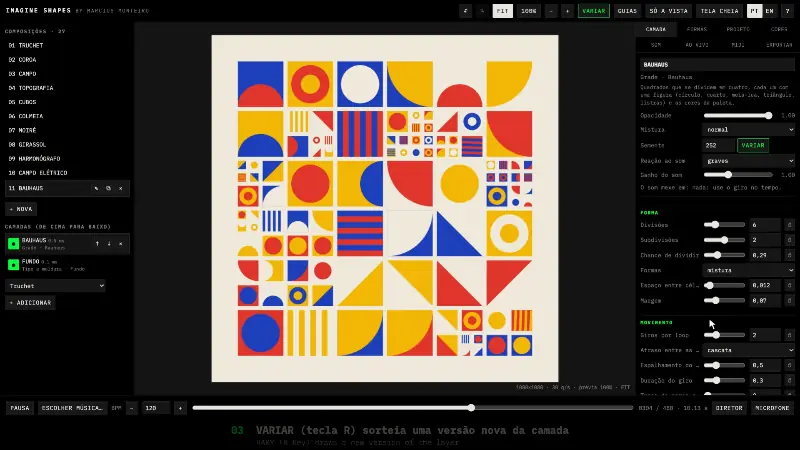</a></p>

**[Assista ao tutorial completo](docs/video/tutorial.mp4)** · 1 min 32 s · 1920×1080 · legendas em português e inglês · som a partir do passo 07. A animação acima é um trecho de 17 segundos (passos 03 a 05).

| Tempo | Passo |
|---|---|
| 0:00 | Tela de abertura: o que é a ferramenta e quem fez |
| 0:07 | **01** · Escolher uma das 27 composições |
| 0:15 | **02** · Camadas e parâmetros: o desenho muda na hora |
| 0:24 | **03** · VARIAR (tecla R): uma versão nova da camada |
| 0:29 | **04** · Aba FORMAS: somar uma camada |
| 0:36 | **05** · Arrastar na prancheta e mudar o tamanho com a roda do mouse |
| 0:41 | **06** · CORES: trocar a paleta |
| 0:48 | **07** · SOM: escolher uma música; as formas reagem |
| 1:00 | **08** · DIRETOR: troca de composição no tempo da música |
| 1:14 | **09** · EXPORTAR: SVG, PNG e MP4 |

O tutorial é a ferramenta sendo usada de verdade, gravada do próprio Chrome. Veja [como os vídeos foram feitos](#como-os-vídeos-e-as-imagens-foram-feitos).

## Como usar

### Em quatro passos

<p align="center">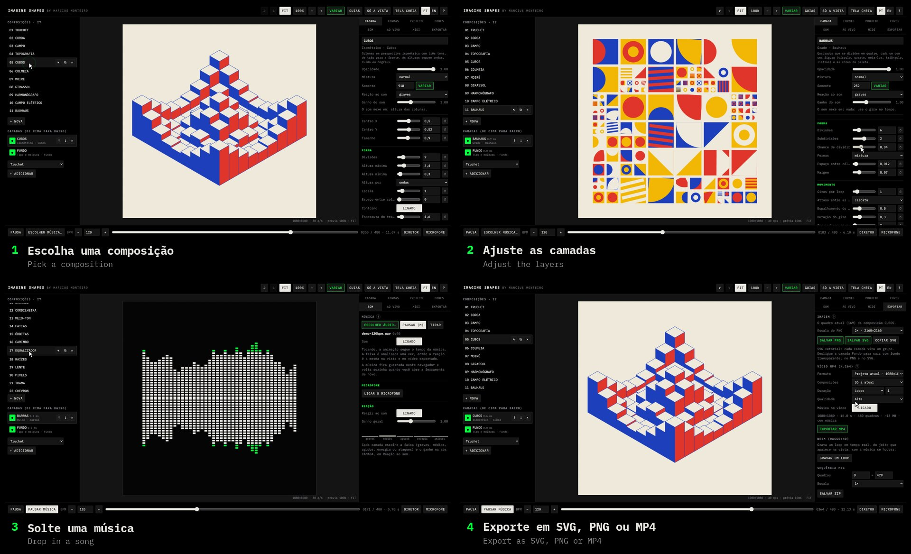</p>

1. **Escolha uma composição** na lista à esquerda, ou crie uma nova.
2. **Ajuste as camadas:** clique numa camada e mexa nos parâmetros da aba CAMADA. VARIAR (tecla R) sorteia outra versão, e a aba FORMAS acrescenta camadas novas.
3. **Solte uma música** (ESCOLHER MÚSICA…, no rodapé): as formas reagem ao som e a animação segue o tempo da faixa.
4. **Exporte** na aba EXPORTAR: SVG vetorial, PNG até 4×, MP4 com a música, WebM ou sequência PNG.

### No navegador

1. Baixe este repositório (botão **Code → Download ZIP**) ou clone com `git clone`.
2. Abra o `index.html` no Chrome ou no Edge. Não precisa instalar nada, nem rodar servidor ou criar conta.
3. A tela de abertura apresenta a ferramenta. Clique em COMEÇAR, escolha uma composição à esquerda e explore. O **?** no topo abre essa tela de novo, com a lista completa de atalhos.
4. Para trocar o idioma, use PT ou EN no topo. A escolha fica salva no navegador.

<p align="center">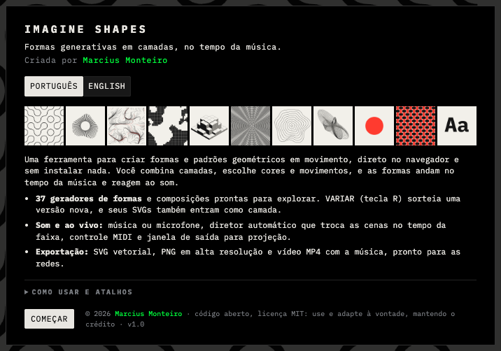</p>

### No seu site

A ferramenta é um site estático: bastam o `index.html` e a pasta `font/`.

1. Copie os dois para uma pasta do site, por exemplo `imagine-shapes/`, e abra o endereço dessa pasta.
2. Use **HTTPS**. A exportação MP4, o microfone e o MIDI só funcionam em página segura (HTTPS, ou o arquivo aberto direto do computador).
3. Cada visitante tem o próprio projeto, guardado no navegador dele. Nada vai para o servidor.

Para mostrar a ferramenta dentro de outra página, use um `iframe` com as permissões de microfone, MIDI e tela cheia:

```html
<iframe src="imagine-shapes/" width="100%" height="820" style="border:0"
        allow="microphone; midi; fullscreen; clipboard-write" allowfullscreen></iframe>
```

A janela de saída (aba AO VIVO) abre uma janela nova do navegador. Para projeção, abra a ferramenta numa página própria.

**GitHub Pages:** em *Settings → Pages*, escolha *Deploy from a branch*, o branch `main` e a pasta `/ (root)`. A ferramenta fica em `https://<usuário>.github.io/<repositório>/`.

### Atalhos principais

| Tecla | Ação |
|---|---|
| Espaço | toca e pausa a animação |
| R | nova variação da camada selecionada (Shift + R: da composição inteira) |
| 1 a 9 | troca a composição, com transição |
| [ ] · , . | composição anterior e seguinte (Page Up e Page Down também, para usar um passador de slides) |
| D | liga e desliga o diretor automático |
| Arrastar na vista | move a camada selecionada; a roda do mouse muda o tamanho |
| ↑ ↓ | seleciona a camada de cima ou de baixo |
| S · Shift + S | salva PNG · salva SVG |
| M | toca e pausa a música |
| G | guias: terços, centro e margem |
| B | blackout da vista e da janela de saída |
| H · F | só a vista · tela cheia |
| ⌘Z · ⇧⌘Z | desfaz e refaz |
| ? | tela de abertura e lista completa de atalhos |

### Navegadores

| Recurso | Chrome e Edge | Firefox e Safari |
|---|---|---|
| Ferramenta, SVG, PNG, sequência PNG | sim | não testados |
| Exportar MP4 (WebCodecs) | H.264 + AAC | não testados (a ferramenta tenta Opus quando não há AAC) |
| Gravar WebM | sim | não testado |
| MIDI (Web MIDI) | sim, depois de permitir | não testado (o Safari não tem Web MIDI) |

A ferramenta foi testada no Chrome, inclusive a exportação MP4 com música. O MIDI foi testado com mensagens simuladas, sem um controlador ligado. O projeto fica salvo no próprio navegador e pode ir para outra máquina como JSON (aba PROJETO), junto com os SVGs importados e os controles MIDI. A música também fica guardada no navegador, mas não vai no JSON. Nada sai do computador: a ferramenta não faz nenhuma chamada de rede.

## Como funciona

<p align="center">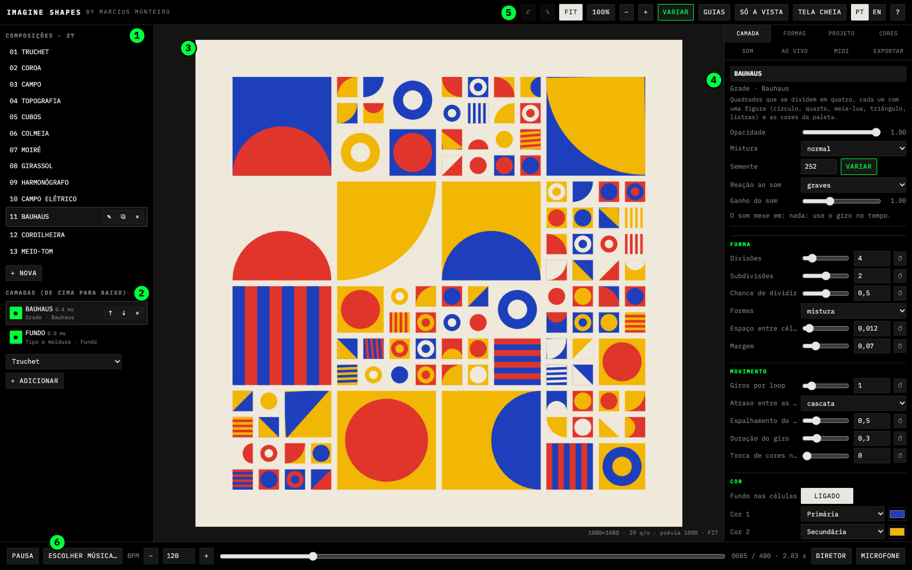</p>

1. **Composições:** as 27 prontas, ou crie a sua. A lista tem rolagem própria, para as camadas continuarem à vista.
2. **Camadas:** a pilha da composição. Ligue, desligue, reordene (arrastando) e ajuste a opacidade e o modo de mistura.
3. **Prancheta:** o quadro final. Arrastar move a camada selecionada; a roda do mouse muda o tamanho.
4. **Painel:** os parâmetros da camada e as abas Formas, Projeto, Cores, Som, Ao vivo, MIDI e Exportar. O **(?)** ao lado de cada seção explica como ela funciona.
5. **Cabeçalho:** desfazer, zoom da prancheta, VARIAR, guias, só a vista e tela cheia.
6. **Tempo:** play da animação, play da música, BPM, posição no loop e os botões DIRETOR e MICROFONE.

### Camadas que se somam

<p align="center">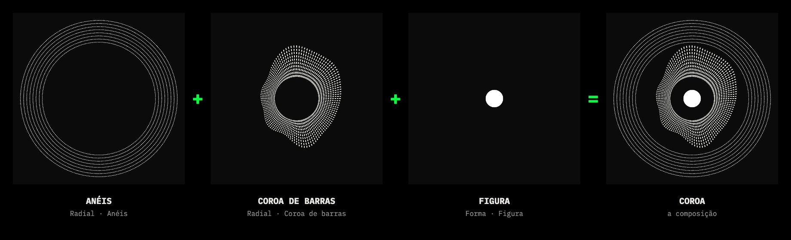</p>

Uma composição é uma pilha de camadas, desenhadas de baixo para cima sobre o Fundo. A COROA, acima, soma três camadas: anéis tracejados, uma coroa de barras e um círculo no centro. Cada camada tem os próprios parâmetros, semente, opacidade e modo de mistura (multiplicar, tela, sobrepor, diferença e outros), e a paleta da composição dá as cores de todas.

### Como tudo se liga

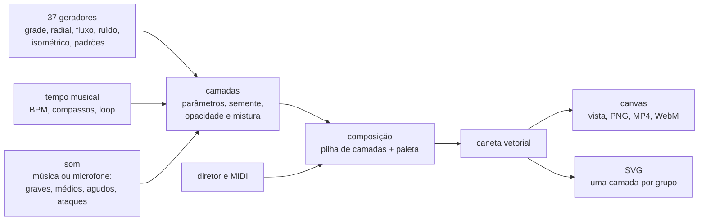

### Uma caneta, dois destinos

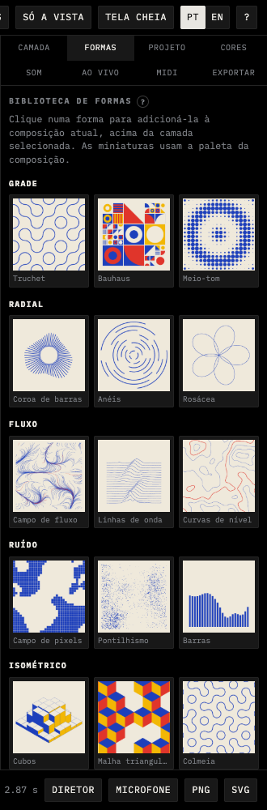

Os geradores não desenham direto no canvas. Eles usam uma caneta vetorial com retângulos, círculos, arcos, polígonos, curvas, recortes, texto e imagens. A caneta pode entregar o desenho a dois destinos:

- **canvas:** a vista e as exportações PNG e de vídeo;
- **SVG:** a exportação vetorial.

Cada camada do SVG vira um grupo, que aparece como camada no Inkscape e como grupo no Illustrator e no Figma. A opacidade e o modo de mistura vão junto. Desligue a camada Fundo para exportar com fundo transparente.

Formas seguidas com o mesmo estilo viram um só caminho. Assim, uma grade de 10.000 pontos é preenchida em poucas operações, e o SVG fica menor.

<br clear="right">

### Semente e variações

<p align="center">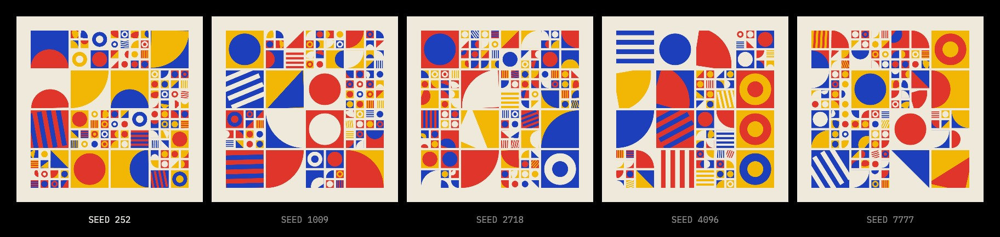</p>

Cada camada tem uma semente, somada à semente do projeto. Todo o acaso dos geradores (orientação das peças, ruído, cores sorteadas) sai dela. A mesma semente dá sempre o mesmo desenho, em qualquer tamanho de tela. Acima, a mesma camada Bauhaus, com os mesmos parâmetros, em cinco sementes.

**VARIAR** (tecla R) sorteia uma semente nova para a camada selecionada; Shift + R, para a composição inteira. O código `{SEED}` da camada Moldura e da camada Texto mostra a variação atual. ⌘Z volta à anterior.

### Tempo musical e loop

<p align="center">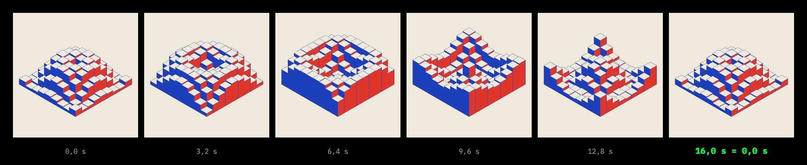</p>

O BPM e os compassos definem um loop (8 compassos a 120 BPM = 16 s). Tudo o que se move dá um número inteiro de voltas no loop:

- **Giros em cliques:** as peças do Truchet, da Colmeia e do Bauhaus giram em passos de 90° ou 60°, sempre no começo do tempo, com atraso em onda, cascata ou diagonal.
- **Ruído que fecha no loop:** o ponto de amostragem do ruído anda num círculo, então o campo muda e volta exatamente ao início.
- **Pulso no tempo:** várias formas pulsam a cada batida.

Assim o vídeo fecha sem emenda: 2 ou 4 loops viram um vídeo mais longo, sem corte. Na imagem acima, os 16 s são o mesmo instante do começo: o loop volta ao primeiro quadro.

### Som

Com uma música carregada (aba **SOM**, botão ESCOLHER MÚSICA… no rodapé, ou solte o arquivo na vista), a faixa é analisada de uma vez: graves, médios, agudos, energia e ataques, 30 vezes por segundo. Tocando, a animação segue o relógio da música. Como a análise é feita antes, a reação é a mesma na vista e no MP4 exportado.

O microfone também funciona, ao vivo. Na aba **CAMADA**, cada camada escolhe a faixa e o ganho. O texto embaixo do controle diz o que o som move naquela forma, por exemplo o comprimento das barras, a altura das montanhas ou a espessura do traço.

A música fica guardada no navegador (IndexedDB) e volta sozinha quando a ferramenta abre de novo. TIRAR, na aba SOM, apaga.

### Ao vivo: diretor e MIDI

- **Diretor automático** (aba AO VIVO, tecla D ou botão DIRETOR no rodapé): troca de composição a cada 1, 2, 4, 8 ou 16 compassos, sempre no começo do compasso e no tempo da música; sem música, vale o BPM do projeto. A ordem segue a lista ou é aleatória, passando por todas antes de repetir. Você marca quais composições entram, e a próxima pisca na lista. No MP4, "Seguir o diretor" calcula a mesma sequência pelo número do quadro: foi assim que o vídeo de demonstração saiu.
- **MIDI** (aba MIDI): LIGAR MIDI e APRENDER. Clique num parâmetro da camada, na opacidade, numa composição ou numa ação (play, música, anterior, próxima, blackout, diretor, variar) e mova um knob ou aperte um pad. PADS → COMPOSIÇÕES liga uma fileira de pads às composições 1, 2, 3… Os controles ficam salvos no projeto e no JSON.

### Formatos

<p align="center">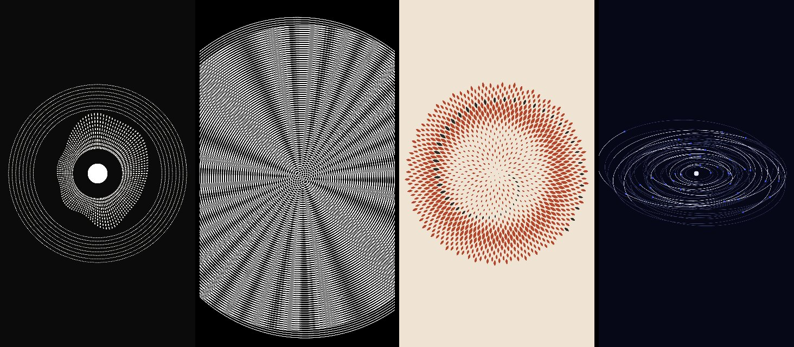</p>

As camadas usam medidas relativas ao lado menor da tela. Quadrado, retrato 4:5, vertical 9:16, paisagem, 4K e cartaz A3 funcionam sem refazer nada, e o MP4 pode sair num formato diferente do projeto.

### Seus SVGs

Importe um ou mais arquivos .svg (aba FORMAS, ou solte na vista). O arquivo é limpo ao entrar: saem scripts, eventos, objetos e links externos, e os ids ganham um prefixo próprio. Depois ele pode ser usado de duas formas:

- **SVG importado:** o arquivo inteiro numa camada, com posição, tamanho, giro, espelho e um movimento próprio: respirar, balançar, flutuar, girar em passos ou deslizar em ladrilhos.
- **Carimbo:** o arquivo repetido em grade, colmeia, anéis, espiral, espalhado ou em onda.

A cor "paleta" reescreve fill e stroke com a cor escolhida, e o resultado continua vetorial. Na exportação SVG, o arquivo entra uma vez como `<symbol>` e é reaproveitado com `<use>`.

## As formas

<p align="center">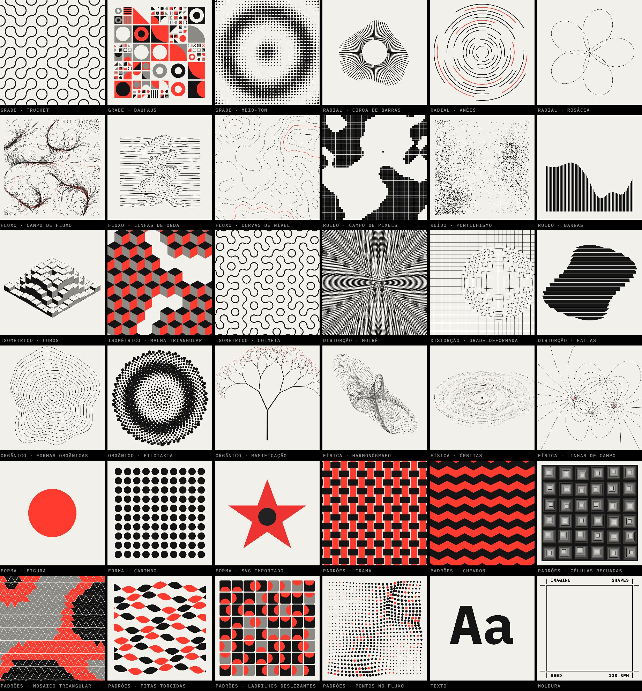</p>

| Família | Formas |
|---|---|
| Grade | **Truchet**: peças que se encaixam em qualquer giro · **Bauhaus**: quadrados que se dividem, cada um com uma figura · **Meio-tom**: retícula de pontos que segue um campo |
| Radial | **Coroa de barras**: barras inteiras ou em segmentos · **Anéis**: arcos, tracejados, pontos e marcas · **Rosácea**: rosáceas, espirógrafos e Lissajous |
| Fluxo | **Campo de fluxo** · **Linhas de onda**, com montanhas que cobrem as de trás · **Curvas de nível** |
| Ruído | **Campo de pixels**: limiar e pontilhado Bayer · **Pontilhismo** · **Barras**: equalizador, código de barras e LED |
| Isométrico | **Cubos** · **Malha triangular**: cubos de três tons, hexágonos e estrelas · **Colmeia**: Truchet hexagonal |
| Distorção | **Moiré** · **Grade deformada**: lente, redemoinho, ondas e pinça · **Fatias** de uma figura ou de uma palavra |
| Orgânico | **Formas orgânicas** · **Filotaxia** · **Ramificação**: árvore, coral e raio |
| Física | **Harmonógrafo** · **Órbitas** pela lei de Kepler · **Linhas de campo** entre cargas elétricas |
| Forma | **Figura** · **Carimbo**: repete uma figura ou um SVG seu · **SVG importado**, com movimentos próprios |
| Padrões | **Trama**: fitas que passam por cima e por baixo · **Chevron**: faixas em zigue-zague · **Células recuadas**: quadros encaixados como túneis · **Mosaico triangular** · **Fitas torcidas**: frente e verso em duas cores · **Ladrilhos deslizantes**: um quebra-cabeça que volta ao lugar · **Pontos no fluxo** |
| Tipo e moldura | **Fundo** · **Texto** · **Moldura**: borda, marcas de corte, réguas e textos nos cantos |

Os 37 geradores foram escritos para esta ferramenta, e nenhum padrão de terceiros vem junto. Todos desenham com uma caneta vetorial que tem dois destinos: o canvas da tela e o SVG da exportação.

## Composições

<p align="center">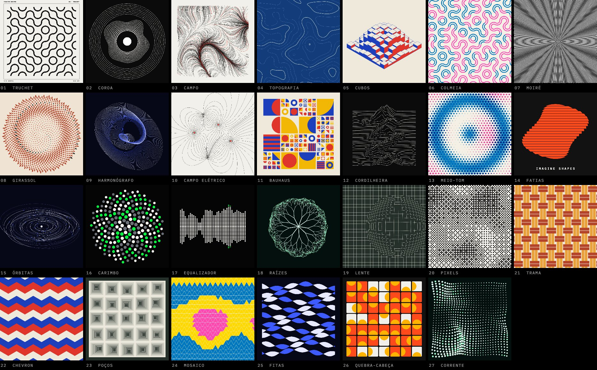</p>

<table>
  <tr>
    <td width="50%">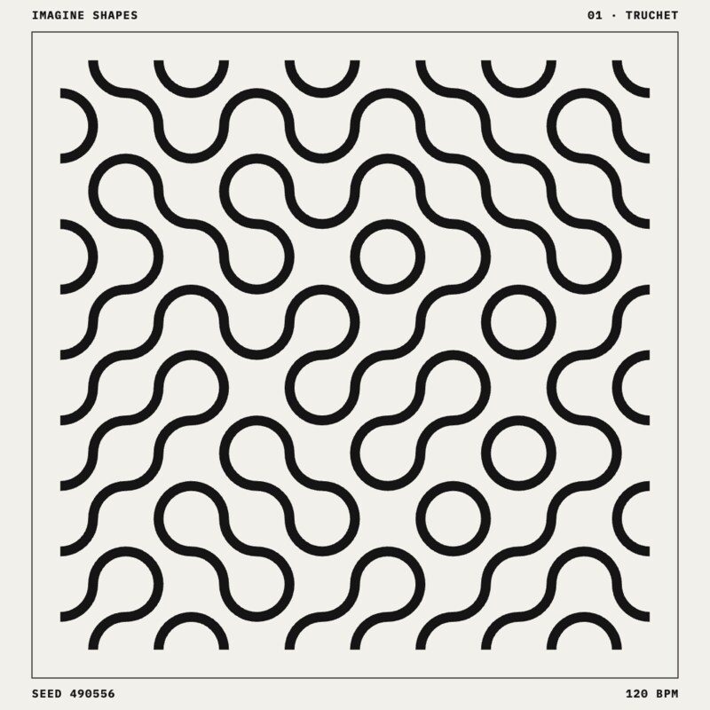<br><b>Truchet</b>: arcos que se ligam de célula em célula. Uma onda de giros passa pela grade a cada 2 compassos, sempre no tempo forte.</td>
    <td width="50%">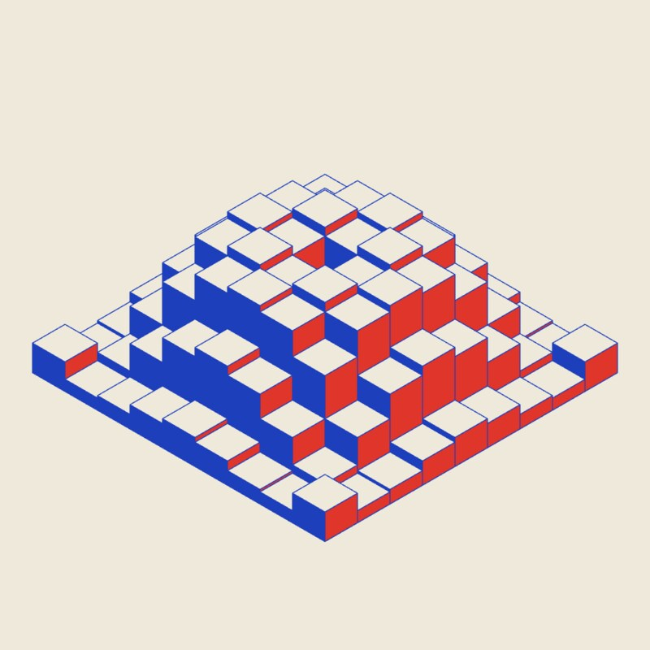<br><b>Cubos</b>: colunas isométricas em três tons, desenhadas de trás para a frente. As alturas sobem em ondas a partir do centro.</td>
  </tr>
  <tr>
    <td>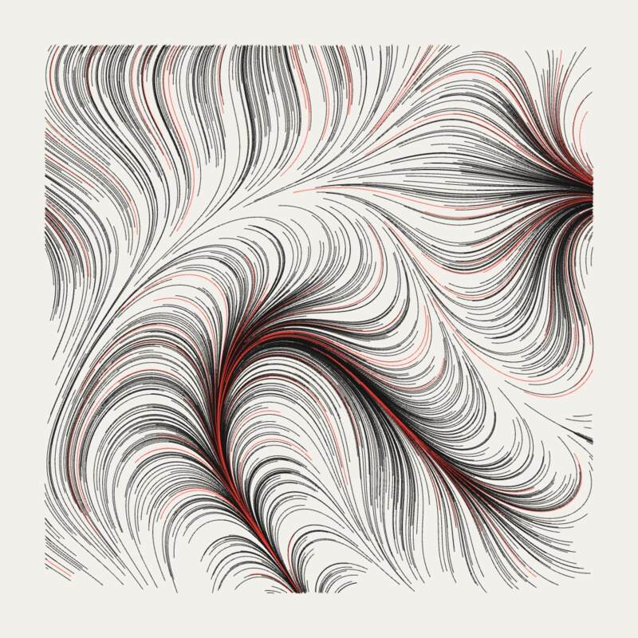<br><b>Campo</b>: 1.500 linhas seguindo um campo de ruído. O campo muda devagar e volta ao início no fim do loop.</td>
    <td>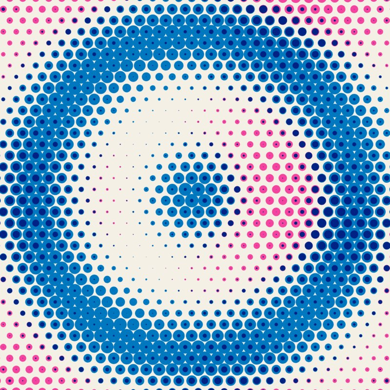<br><b>Meio-tom</b>: duas retículas hexagonais em multiplicação, como uma impressão em risografia.</td>
  </tr>
  <tr>
    <td>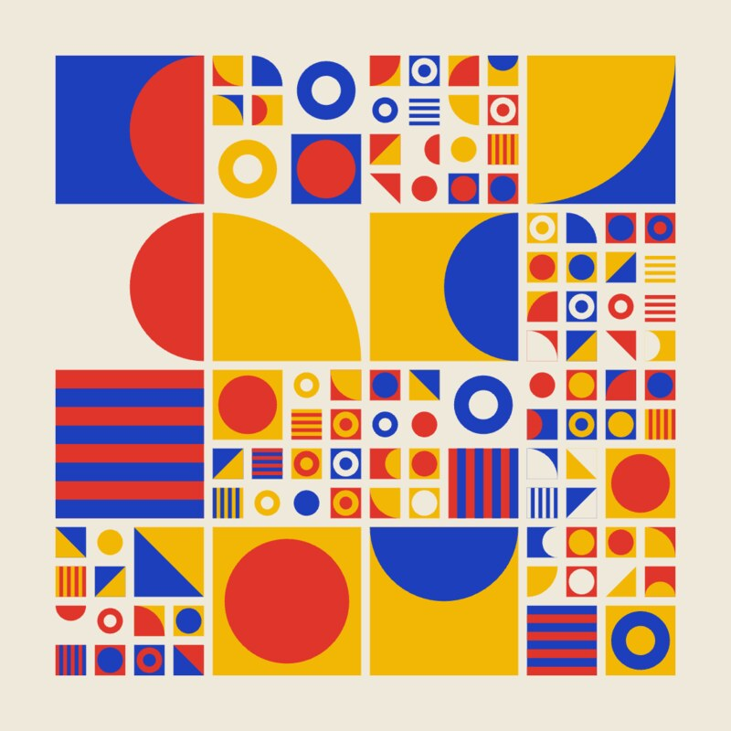<br><b>Bauhaus</b>: quadrados que se dividem em quatro, cada um com uma figura nas cores da paleta.</td>
    <td>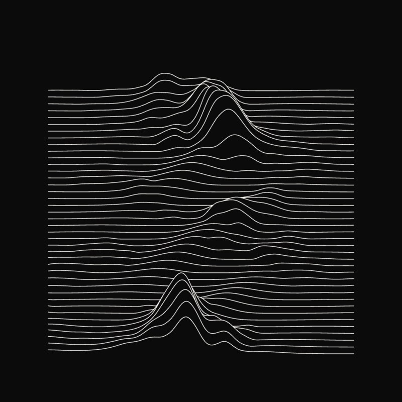<br><b>Cordilheira</b>: linhas que se levantam em picos, cada uma cobrindo as de trás.</td>
  </tr>
  <tr>
    <td>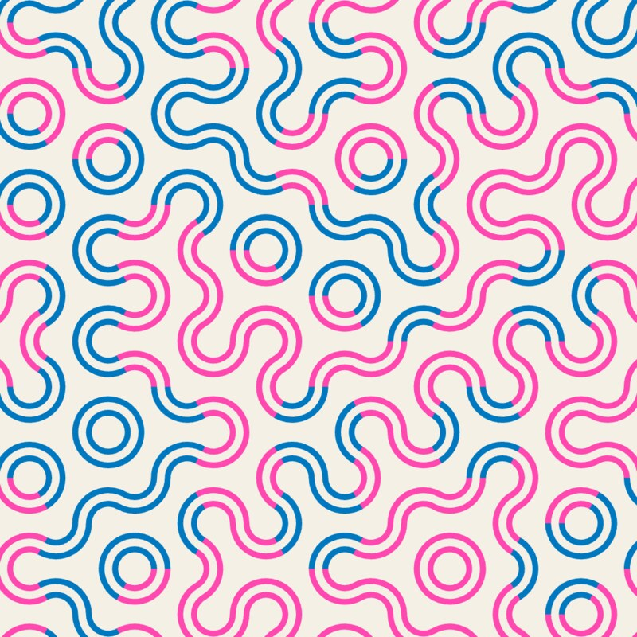<br><b>Colmeia</b>: hexágonos com arcos duplos que formam caminhos sem fim, girando em cliques de 60°.</td>
    <td>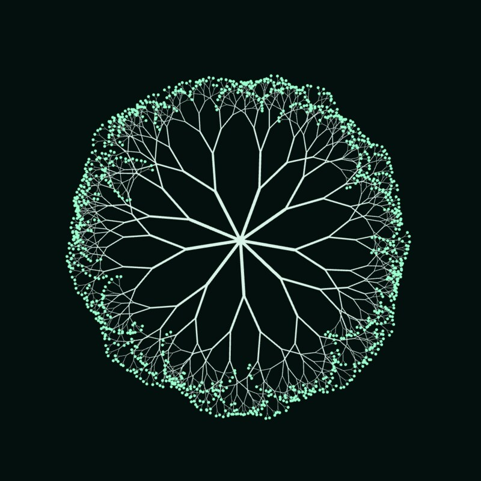<br><b>Raízes</b>: nove troncos que se ramificam a partir do centro e balançam no tempo.</td>
  </tr>
  <tr>
    <td>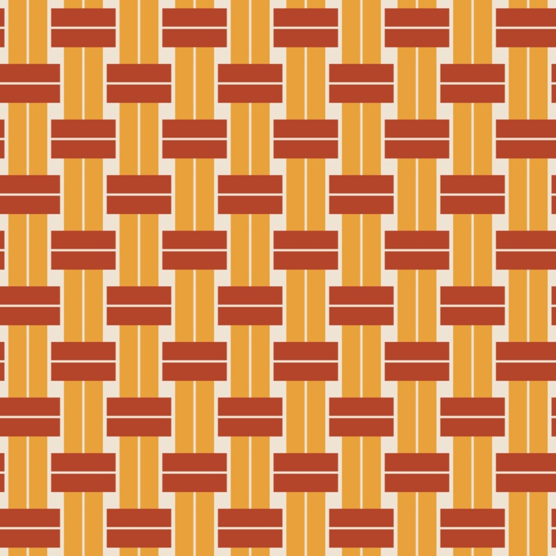<br><b>Trama</b>: fitas listradas que passam por cima e por baixo, como num tecido. A trama corre na diagonal e volta ao ponto de partida no fim do loop.</td>
    <td>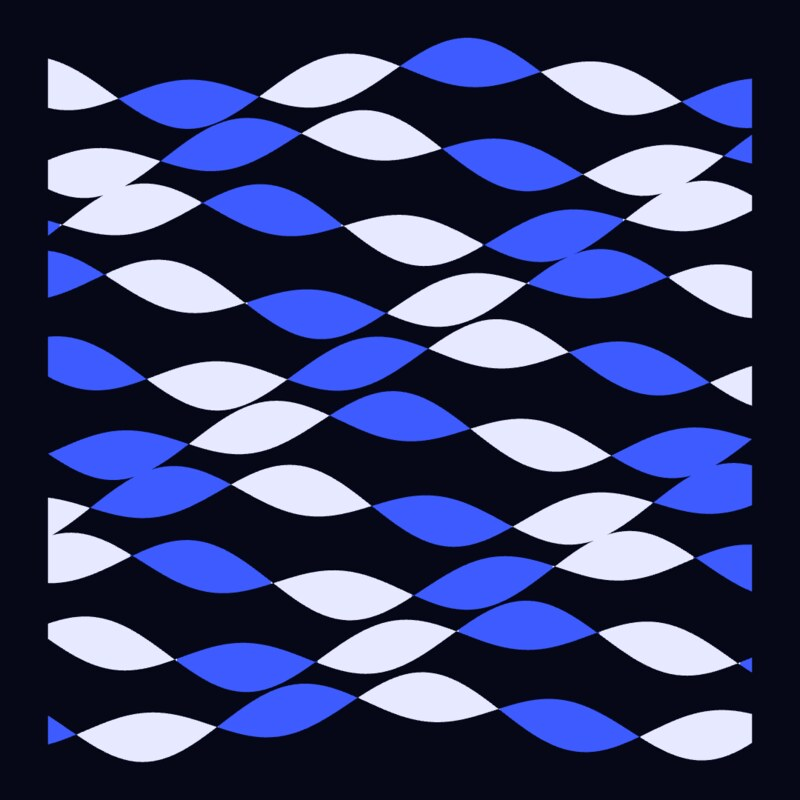<br><b>Fitas</b>: dez fitas que torcem no próprio eixo, mostrando a frente e o verso em duas cores. As torções correm com atraso de uma fita para a outra.</td>
  </tr>
</table>

## Vídeos

| Vídeo | Formato | Para quê |
|---|---|---|
| [**Tutorial**](docs/video/tutorial.mp4) | 1 min 32 s · 1920×1080 · legendas PT e EN · com som | aprender a usar a ferramenta (veja o [índice por tempo](#tutorial)) |
| [**Demonstração**](docs/video/demo.mp4) | 40 s · 1080×1080 · com som | mostrar o resultado: dez composições no tempo da música |
| [**Demonstração vertical**](docs/video/demo-vertical.mp4) | 40 s · 1080×1920 · com som | Reels e Stories |

<p align="center"><a href="docs/video/demo.mp4">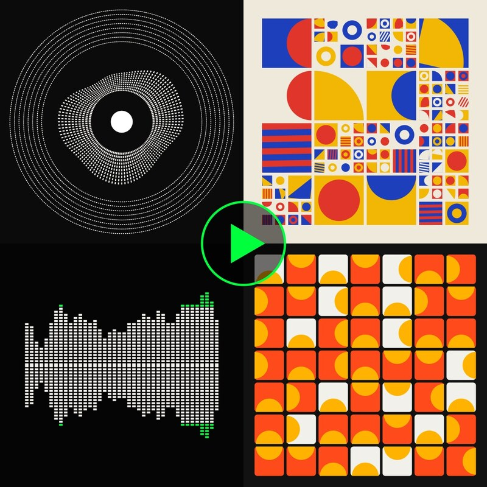</a></p>

Na demonstração, o diretor automático troca entre dez composições a cada 2 compassos, no tempo de uma faixa de 120 BPM feita para o vídeo e sintetizada no próprio navegador. As formas reagem aos graves; na pausa antes do fim, a batida some e as fitas seguem sozinhas. A própria ferramenta exportou os dois vídeos de demonstração, quadro a quadro.

## Como foi desenvolvida

A ferramenta foi criada por Marcius Monteiro em novembro de 2026. Tudo cabe num arquivo só: camadas registradas com `reg()`, composições, tempo musical e exportação de vídeo no navegador.

O código foi escrito em parceria com o [Claude Code](https://claude.com/claude-code) (Anthropic).

**Linha do tempo**

- **19 de novembro de 2026:** primeira versão, com 30 geradores em 10 famílias, as composições de exemplo, a caneta vetorial, a reação ao som e a exportação em SVG, PNG e vídeo.
- **23 de novembro de 2026:**
  - a família Padrões (7 geradores, cada peça com movimento próprio) e mais 7 composições;
  - a aba AO VIVO, com o diretor automático, e a aba MIDI;
  - a música guardada no navegador e o botão de música no rodapé;
  - a correção do atraso do áudio AAC no MP4;
  - o favicon, a tela de abertura com os créditos, os vídeos e este README.

**Técnica**

- **Um arquivo só:** o `index.html` (~285 KB) tem o HTML, o CSS e o JavaScript, sem bibliotecas, sem build e sem dependências. Abre com duplo clique.
- **Caneta vetorial:** a matriz atual entra nos pontos na hora do desenho, e o mesmo caminho vira operações de canvas ou um `<path>` do SVG. Os lotes fecham a cada 1.200 números no canvas e a cada 8.000 no SVG, para que milhares de formas sobrepostas continuem rápidas.
- **Acaso com semente:** hash inteiro por camada e ruído de Perlin 3D com a permutação sorteada pela semente.
- **Diretor:** a sequência sai do número do quadro e da semente do projeto, então o MP4 que segue o diretor sai igual em qualquer máquina.
- **MIDI e música guardada:** Web MIDI, com modo aprender; a música fica no IndexedDB do navegador.
- **Música:**
  - análise por FFT própria (2.048 pontos, 30 leituras por segundo);
  - ataques pelo fluxo espectral.
- **Exportação:**
  - **MP4:** WebCodecs (H.264), com o áudio em AAC (ou Opus) e o contêiner MP4 montado à mão. O atraso de partida do codificador AAC (2.112 amostras no Mac) é medido na hora e compensado, para o som cair no quadro certo.
  - **Sequência PNG:** ZIP escrito à mão.
  - **WebM:** MediaRecorder.

**Testes.** Os testes rodam a ferramenta num Chrome sem janela, comandado por um script Node sem dependências (Chrome DevTools Protocol), com cliques e teclas de verdade.

- **Canvas × SVG:** cada composição foi desenhada pelo canvas e pelo SVG exportado e comparada pixel a pixel. A diferença média ficou abaixo de 1 em 255 em 24 das 27 composições. Nas outras três, a diferença vem só do antialiasing de linhas finas.
- **Parâmetros aleatórios:** os 37 geradores passaram por 1.480 combinações aleatórias de parâmetros (40 por gerador), sem erros e sem valores inválidos no SVG.
- **Emenda do loop:** em todas as composições e em todos os geradores com movimento, a passagem do último quadro para o primeiro muda tanto quanto a passagem entre dois quadros seguidos, sem salto. Esse teste achou um salto nas Fitas torcidas (a ondulação dava meia volta por loop), já corrigido.
- **MP4:** a exportação foi conferida decodificando o próprio vídeo no navegador.
- **Diretor:** testado em tempo real. A 240 BPM, as trocas caíram nos quadros 30, 60, 90 e 120, o começo de cada compasso, e a ordem aleatória passou por todas as composições antes de repetir. No MP4 que segue o diretor, cada trecho decodificado bate com a composição esperada, e as batidas do áudio caem no tempo das imagens.
- **Música e MIDI:** a música guardada voltou depois de recarregar a página. O MIDI foi testado com mensagens simuladas: knobs, pads, ações e o modo aprender.

### Como os vídeos e as imagens foram feitos

- **Imagens:** todas as imagens deste README saíram da própria ferramenta, desenhadas pelo mesmo motor: as composições, as camadas separadas, as sementes e os quadros do loop.
- **Demonstração:** exportada pela aba EXPORTAR, seguindo o diretor, com uma faixa sintetizada no navegador (Web Audio), sem samples nem trechos de terceiros.
- **Tutorial:**
  - a ferramenta foi usada por um roteiro de cliques, arrastes e teclas num Chrome sem janela, e a tela foi gravada quadro a quadro (1920×1008, cerca de 37 quadros por segundo);
  - o cursor, o anel dos cliques e as teclas aparecem desenhados por cima da página;
  - as legendas, o cartão final e a música foram montados num MP4 pelo mesmo codificador da ferramenta (WebCodecs e o contêiner MP4 escrito à mão).

## Estrutura do repositório

```
index.html            a ferramenta inteira (HTML, CSS e JavaScript), com o aviso de crédito e a licença no topo
font/                 IBM Plex Mono e a licença dela (SIL OFL 1.1)
docs/MANUAL.md        manual completo: cada forma, aba, código e atalho
docs/img/             imagens deste README, geradas pela ferramenta
docs/img/social-preview.png   imagem de prévia para o GitHub (Settings → Social preview)
docs/video/           tutorial, demonstração quadrada e vertical
LICENSE               licença MIT
```

Para criar uma forma nova, acrescente um `reg(...)` e uma entrada em `FAMILIES` no `index.html`. O [manual](docs/MANUAL.md#estrutura-do-código) descreve a estrutura do código e traz um exemplo.

## Créditos e licença

- **Criação:** [Marcius Monteiro](https://marciusm.com).
- **Código:** licença [MIT](LICENSE). Use, modifique e distribua à vontade, mantendo o aviso de copyright. O aviso e a licença estão também no topo do `index.html`, para acompanhar o código mesmo quando ele é copiado sozinho.
- **Formas:** todas são desenhadas pelos geradores do `index.html`, e nenhum padrão de terceiros vem incluído. Os SVGs que você importa continuam sob a licença de quem os criou.
- **Música dos vídeos:** feita para a demonstração e sintetizada no próprio navegador (Web Audio), sem samples nem trechos de terceiros. O tutorial usa a mesma faixa.
- **Fonte tipográfica:** [IBM Plex Mono](https://github.com/IBM/plex), © IBM Corp., licença SIL Open Font License 1.1 ([`font/OFL.txt`](font/OFL.txt)).

### Como dar o crédito

Se você usar, adaptar ou mostrar esta ferramenta (ou partes do código) num projeto, mantenha o aviso do topo do `index.html` e cite:

```
IMAGINE SHAPES, de Marcius Monteiro (marciusm.com)
```

---

## In English

**IMAGINE SHAPES** is a generative shapes tool for posters, video and live projection, created by [Marcius Monteiro](https://marciusm.com). Grids, rays, flows, noise, isometrics, distortions, organic forms, physics and patterns are layers that combine into compositions. They move in time with the music, react to sound and come out as real vectors.

- **Tutorial:** a [1 min 32 s video](docs/video/tutorial.mp4) of the tool in use, with Portuguese and English subtitles (the [time index](#tutorial) is above).
- **Shapes:** 37 generators in 11 families and 27 example compositions, all with adjustable parameters. Every generator was written for this tool, and no third-party patterns are included.
- **Vector first:** generators draw with a pen that has two targets, the canvas and SVG. Each frame exports as SVG with one group per layer (a layer in Inkscape). What you see is the same drawing that goes into the file.
- **Variations:** each layer has a seed. The R key draws a new one, and the same seed always gives the same drawing.
- **Your SVGs:** import .svg files (they are sanitized on import) and use them as a layer or repeated by the Stamp, in their own colors or a palette color.
- **Sound:** drop a song and layers react to bass, mids, highs and attacks. The track is analyzed once, so the reaction is identical live and in the exported video. The microphone works live too. The song is kept in the browser and comes back on its own.
- **Output:**
  - vector SVG, and PNG up to 4×;
  - MP4 (H.264 + AAC, encoded in the browser) for Reels, feed and YouTube;
  - WebM and PNG sequence.
- **Live:** an auto director that switches compositions every few bars in time with the music (the MP4 export can follow it), MIDI control with a learn mode, an output window for the projector, keys 1 to 9 and [ ], and blackout.
- **Demo video:** [square](docs/video/demo.mp4) and [vertical](docs/video/demo-vertical.mp4), 40 s with sound, exported by the tool itself.
- **Run it:** open `index.html` in Chrome or Edge (Firefox and Safari are untested). There is nothing to install.
- **On your own site:** upload `index.html` and `font/` to any static host over HTTPS (MP4 export, microphone and MIDI need a secure page). To embed it, use an `iframe` with `allow="microphone; midi; fullscreen; clipboard-write"`.
- **Built as a single HTML file** with Canvas 2D and no dependencies, written in collaboration with Claude Code. It was tested in headless Chrome driven over the DevTools Protocol, with real clicks and keys.
- **Language:** English and Portuguese, with the PT/EN switch at the top or on the opening screen, or `index.html?lang=en`. The [manual](docs/MANUAL.md) is in Portuguese.
- **License:** code under [MIT](LICENSE). Keep the copyright notice (it is also at the top of `index.html`) and please credit *"IMAGINE SHAPES by Marcius Monteiro (marciusm.com)"*. The IBM Plex Mono font is under the SIL OFL 1.1.
